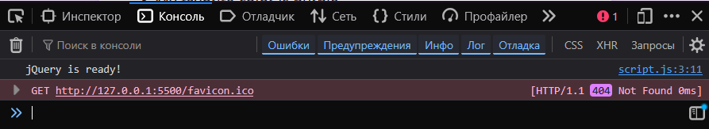
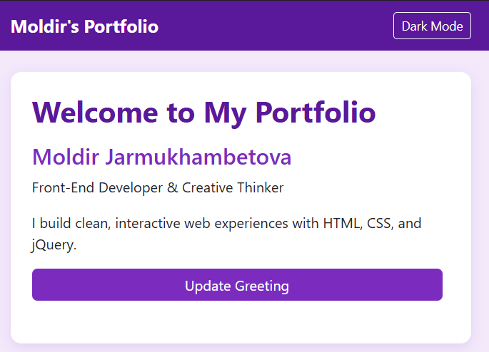
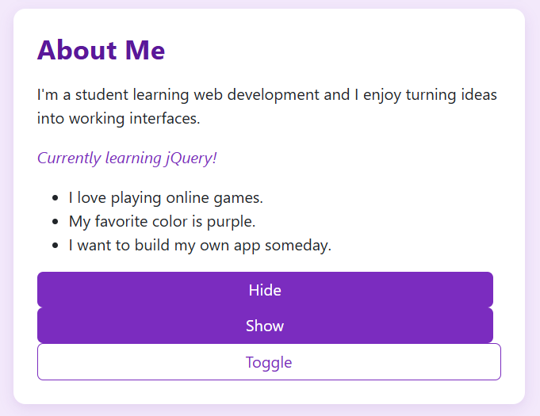
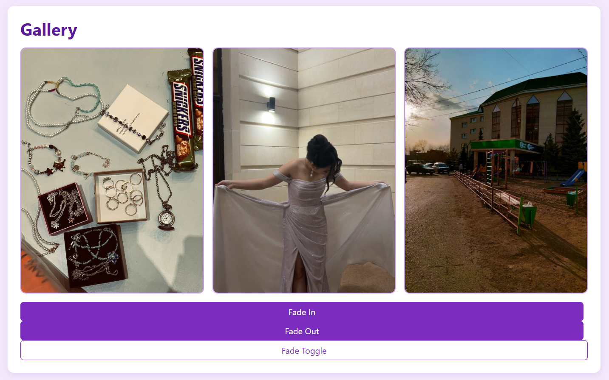
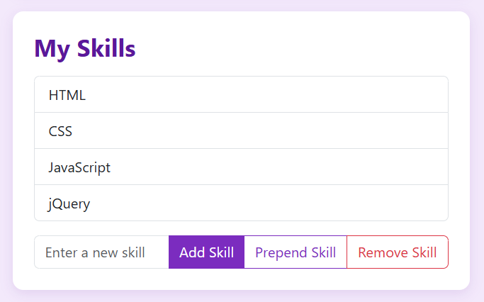
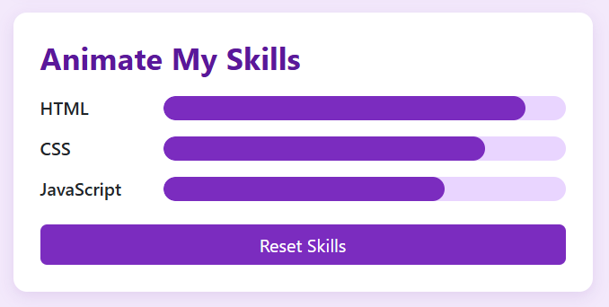
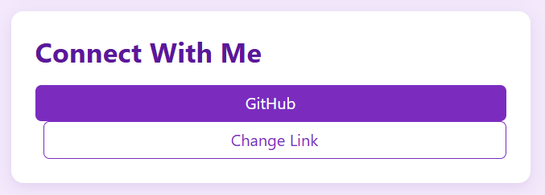
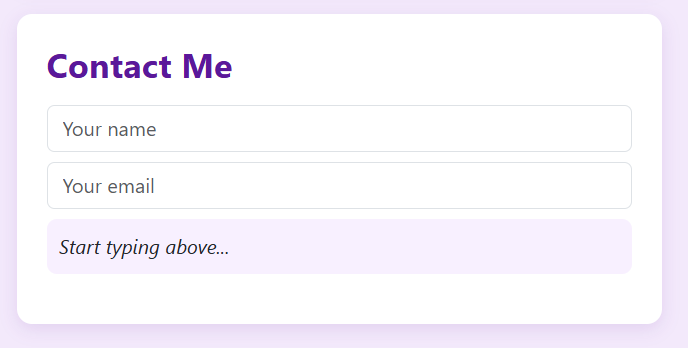

# Assignment 6 — jQuery Portfolio

**Name:** Moldir Jarmukhambetova  
**Group:** SE-2540

A single-page portfolio covering all jQuery tasks — selectors and CSS manipulation, visibility methods, fade and slide effects, DOM add/remove, attribute modification, live form interaction, and skill bar animations.

**Live site (GitHub Pages):** https://jarmumoldir-png.github.io/assignment6_web1/

---

## Task 0: Setup

Included jQuery 3.7.1 from the jsDelivr CDN in the <head> of index.html, and wrapped all my code in $(document).ready(function () { ... }) inside script.js. To test that jQuery loaded correctly, I added console.log("jQuery is ready!") as the first line inside the ready function. The confirmation appears in the browser console (opened with F12 -> Console tab).

---

## Task 1: Selectors & CSS

Built a profile section with my name, a headline, and a short intro. I used three selector types from the lecture:

- **ID selector** #updateGreetingBtn for the button
- **Class selector** .headline and .intro for the text
- **Tag selector** via the .section-title class on the <h1>

When "Update Greeting" is clicked, .text() and .html() change the headline and intro. The **Dark Mode** button in the navbar uses .toggleClass() to switch a dark-mode class on <body>, and the CSS handles the color changes. I also used .css() styling through the dark-mode class since the assignment mentions changing styling of selected elements.

---

## Task 2: Visibility Methods

Added an "About Me" section with a short biography, a status message ("Currently learning jQuery!"), and three fun facts. Three buttons control visibility:

- **Hide** - .hide() on #statusMsg and #funFacts
- **Show** - .show() on both
- **Toggle** - .toggle() on both

I selected both elements with one jQuery call using the comma selector $("#statusMsg, #funFacts") so I only write the method once.

---

## Task 3: Fade Methods

Added a gallery with three images from my images/ folder. Three buttons use:

- .fadeIn(800) — bring all images back
- .fadeOut(800) — fade all images out
- .fadeToggle(800) — toggle between the two

I set the duration to 800ms so the effect is clearly visible rather than instant.

---

## Task 4: Slide Methods

Created three clickable headings — My Favorite Music, My Favorite TV Series, My Favorite Subject — each with a hidden panel underneath. On heading click, I read the data-target attribute, build the selector with "#" + target, and call .slideToggle(400) on the panel.

I used data-target instead of hardcoding three separate click handlers, so all three headings share the same code.

---

## Task 5: Add & Remove Elements

The skills list starts with HTML, CSS, JavaScript, and jQuery. An input field and three buttons:

- **Add Skill** - .append() adds the new <li> to the end of the list
- **Prepend Skill** - .prepend() adds it to the start
- **Remove Skill** - .remove() on the last <li>

I added an empty check: if .val().trim() returns an empty string, an alert appears and nothing is added. After a successful add, the input is cleared with .val("").

---

## Task 8: Basic Animation

The skill bars start at zero width. Each .skill-fill element stores its target width in a data-width attribute. When **Animate My Skills** is clicked:

- For each bar, I read the target with .data("width") and call .animate({ width: targetWidth }, 900).
- A grown boolean tracks whether bars are open or closed.
- Clicking again animates all bars back to 0%, and the button label switches between "Animate My Skills" and "Reset Skills".

---

## Task 6: Modifying Attributes

A "Connect With Me" section with a link to my GitHub profile. The **Change Link** button uses .attr("href", ...) to swap the destination to my Instagram profile and .text() to update the visible label. A linkToggled boolean tracks the current state so the button switches back and forth between the two links.

---

## Task 7: Form Interaction

A contact form with Name and Email inputs. Both inputs share an .on("input", ...) handler that reads the current values with .val() and displays them live below the form using .text(). The preview updates on every keystroke.

---

## Summary

I built one HTML page with all tasks as separate sections and styled it with a purple theme. The navbar Dark Mode button switches the whole page between light and dark using a single dark-mode class on <body>, and every section's colors are defined in styles.css for both modes.

The jQuery code is in script.js inside $(document).ready(). The biggest takeaways for me were: 1. using 'data-' attributes to store per-element values (like each bar's target width and each panel's target ID) instead of hardcoding them, and 2. using .on("input", ...) for the live preview — I'd only used .click() before this assignment, so wiring the form up to update on every keystroke took some trial and error. Task 8 also pushed me to re-read the .animate() docs because the animation only works if the CSS property you're animating has a numeric value.